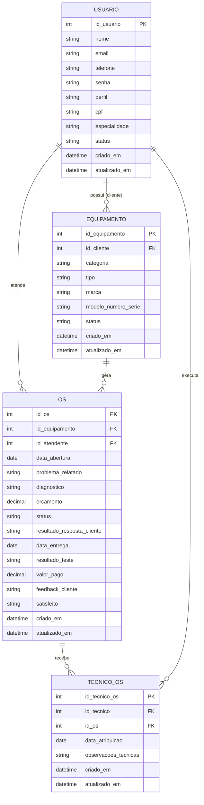

# DER Simplificado

Modelo de dados do sistema: 4 tabelas, sem controle de estoque. Substitui o modelo anterior (`PIM - Modelagem Banco de Dados.brM3`), com 10 entidades, das quais 4 destinadas apenas a separar Admin/Técnico/Recepcionista/Cliente como tabelas próprias por meio de relação "SE".

Nomenclatura no padrão singular e em português. Cada tabela representa uma entidade - um registro corresponde a uma instância, não a uma coleção: `usuario`, `equipamento`, `os`, `tecnico_os`.

## Por que 4 tabelas

- **`usuario` única:** Administrador, Recepcionista, Técnico e Cliente são a mesma entidade; o que os diferencia é o campo `perfil`. A especificidade do técnico (especialidade) fica no mesmo registro, sem uma tabela `Tecnico` separada.
- **Ativação/inativação em vez de exclusão:** `usuario.status` e `equipamento.status` (`ativo` \| `inativo`) substituem a exclusão física de registros (RN12). Um funcionário desligado ou um equipamento fora de uso é inativado, preservando o histórico das ordens de serviço relacionadas.
- **Sem estoque:** peças e estoque não fazem parte do escopo do sistema. Não existem as tabelas `item_os` nem `estoque`.
- **Um ou mais técnicos por OS:** `tecnico_os` é uma tabela associativa. Uma ordem de serviço pode ter 0, 1 ou vários técnicos, cada um em sua própria linha.
- **Chaves estrangeiras simples, sem coluna redundante:** `os.id_atendente`, `tecnico_os.id_tecnico` e `equipamento.id_cliente` são chaves estrangeiras simples para `usuario.id_usuario`. O perfil correspondente a cada uma (RN15, RN16) é reforçado por trigger, sem coluna adicional dedicada à restrição - ver seção seguinte.
- **Hardware e software na mesma tabela:** `equipamento.categoria` (`hardware` \| `software`) evita uma tabela separada para licenças de software; o registro de uma licença usa os mesmos campos de um equipamento físico.
- **Unicidade e consistência de status:** `email`/`cpf` únicos (RN13) e a restrição entre `status` inativo e ordem de serviço em andamento (RN14) evitam login duplicado e inconsistências como a inativação de um técnico durante um reparo.
- **Chaves nomeadas por tabela (`id_<tabela>`):** toda chave primária e estrangeira segue o padrão `id_usuario`, `id_equipamento`, `id_os`, `id_tecnico_os`, nunca um `id` genérico - a origem de cada coluna é identificável pelo próprio nome.
- **Colunas de rastreio em todas as tabelas:** `criado_em` e `atualizado_em` registram a data de criação e da última alteração de cada registro, para fins de auditoria e de relatórios/indicadores (RF10).

## Integridade de papel: `tecnico_os` e `equipamento`

Uma chave estrangeira simples (`tecnico_os.id_tecnico -> usuario.id_usuario`, `equipamento.id_cliente -> usuario.id_usuario`) garante apenas que o `id_usuario` referenciado existe, não que esse usuário tem o `perfil` esperado. Sem reforço adicional, um erro de código ou uma atualização indevida poderia associar em `tecnico_os` o id de um Recepcionista, ou vincular um `equipamento` ao id de um Técnico em vez de um Cliente, sem que o banco rejeitasse o registro.

Essa restrição pode ser reforçada em SQL de duas formas: por chave estrangeira composta contra uma coluna redundante que armazena cópia do `perfil` esperado, ou por trigger. O sistema usa triggers, sem coluna redundante: nem `tecnico_os` nem `equipamento` recebem uma coluna adicional apenas para viabilizar a restrição.

```sql
-- RN15: tecnico_os.id_tecnico so pode referenciar um usuario com perfil
-- tecnico ou admin (admin cobre a ausencia de tecnico, RN11).
CREATE TRIGGER trg_tecnico_os_valida_perfil
ON tecnico_os
AFTER INSERT, UPDATE
AS
BEGIN
    SET NOCOUNT ON;
    IF EXISTS (
        SELECT 1
        FROM inserted i
        JOIN usuario u ON u.id_usuario = i.id_tecnico
        WHERE u.perfil NOT IN ('tecnico', 'admin')
    )
    BEGIN
        RAISERROR('id_tecnico deve referenciar um usuario com perfil tecnico ou admin', 16, 1);
        IF @@TRANCOUNT > 0 ROLLBACK TRANSACTION;
    END
END;

-- RN16: equipamento.id_cliente so pode referenciar um usuario com perfil
-- cliente.
CREATE TRIGGER trg_equipamento_valida_cliente
ON equipamento
AFTER INSERT, UPDATE
AS
BEGIN
    SET NOCOUNT ON;
    IF EXISTS (
        SELECT 1
        FROM inserted i
        JOIN usuario u ON u.id_usuario = i.id_cliente
        WHERE u.perfil <> 'cliente'
    )
    BEGIN
        RAISERROR('id_cliente deve referenciar um usuario com perfil cliente', 16, 1);
        IF @@TRANCOUNT > 0 ROLLBACK TRANSACTION;
    END
END;
```

Sintaxe do SQL Server (T-SQL), igual ao [`schema_sqlserver.sql`](./schema_sqlserver.sql). O T-SQL não tem trigger `BEFORE ... FOR EACH ROW`: cada trigger roda `AFTER INSERT, UPDATE`, confere todas as linhas afetadas pela tabela virtual `inserted` e desfaz a operação (`ROLLBACK`) quando alguma viola a regra. Por isso um único trigger por tabela cobre INSERT e UPDATE.

### Alternativa não adotada: chave estrangeira composta

A alternativa a um trigger é uma chave estrangeira composta: uma coluna redundante na tabela filha (por exemplo, `perfil_tecnico`), com a chave estrangeira simples substituída por uma composta apontando para duas colunas de `usuario` ao mesmo tempo (`FOREIGN KEY (id_tecnico, perfil_tecnico) REFERENCES usuario (id_usuario, perfil)`). A abordagem é inteiramente declarativa, mas acrescenta a cada tabela protegida uma coluna sem uso para o negócio, existente apenas para viabilizar a restrição - por isso não foi adotada.

| Critério | Trigger (adotado) | Chave estrangeira composta |
|---|---|---|
| Local da regra | Código procedural no banco | Estrutura da tabela (`CREATE TABLE`) |
| Coluna adicional | Não | Sim - cópia do `perfil`, sem uso pelo negócio |
| Mensagem de erro | Customizável, referencia a RN diretamente | Genérica do motor ("FOREIGN KEY constraint failed") |
| Cobertura de UPDATE | Sim, com o trigger de `UPDATE` correspondente | Sim, automaticamente |
| Portabilidade | Sintaxe de trigger varia entre SGBDs | SQL padrão, sem alteração entre SGBDs |

### Alteração de perfil após vínculo existente

O sistema não possui uma operação dedicada de alteração de perfil, mas RF02 permite "alterar" um usuário sem excluir o campo `perfil` dessa operação. Os dois triggers anteriores não cobrem esse caso isoladamente: cada um reage a alterações na própria tabela (`id_tecnico` em `tecnico_os`, `id_cliente` em `equipamento`), não a uma alteração de `usuario.perfil`. Um técnico cujo perfil muda para `admin` permanece válido (RN11 já admite `admin`); um técnico cujo perfil mudasse para `recepcionista` deixaria linhas de `tecnico_os` inconsistentes sem que o banco identificasse o problema.

Um terceiro trigger, em `usuario`, verifica as duas tabelas dependentes do perfil antes de aceitar a alteração:

```sql
CREATE TRIGGER trg_usuario_valida_troca_perfil
ON usuario
AFTER UPDATE
AS
BEGIN
    SET NOCOUNT ON;
    IF EXISTS (
        SELECT 1
        FROM inserted i
        JOIN deleted d ON d.id_usuario = i.id_usuario
        WHERE i.perfil <> d.perfil
          AND (
              (EXISTS (SELECT 1 FROM tecnico_os WHERE id_tecnico = i.id_usuario) AND i.perfil NOT IN ('tecnico', 'admin'))
              OR (EXISTS (SELECT 1 FROM equipamento WHERE id_cliente = i.id_usuario) AND i.perfil <> 'cliente')
          )
    )
    BEGIN
        RAISERROR('novo perfil e incompativel com vinculos existentes em tecnico_os ou equipamento', 16, 1);
        IF @@TRANCOUNT > 0 ROLLBACK TRANSACTION;
    END
END;
```

Se o `id_usuario` está referenciado em `tecnico_os.id_tecnico`, o novo perfil deve permanecer em `('tecnico', 'admin')`; se está referenciado em `equipamento.id_cliente`, deve permanecer `'cliente'`. A alteração é rejeitada quando qualquer uma das duas condições é violada. Validado no SQL Server: a alteração de perfil de um técnico com atribuição ativa é rejeitada; a alteração para `admin` (RN11) é aceita; a alteração de perfil de um usuário sem vínculo existente é aceita.

## Integridade de status: vínculos com usuário/equipamento inativo (RN14)

RN14 é reforçada por dois pares de triggers.

O primeiro impede a vinculação de um registro inativo a uma nova ordem de serviço: ao abrir uma OS (`INSERT INTO os`), o equipamento, o cliente proprietário do equipamento e o atendente devem estar com `status = 'ativo'`; ao atribuir um técnico (`INSERT INTO tecnico_os`), o técnico também deve estar ativo.

```sql
CREATE TRIGGER trg_os_valida_ativos
ON os
AFTER INSERT
AS
BEGIN
    SET NOCOUNT ON;
    IF EXISTS (
        SELECT 1
        FROM inserted i
        JOIN equipamento e ON e.id_equipamento = i.id_equipamento
        JOIN usuario cli ON cli.id_usuario = e.id_cliente
        JOIN usuario atd ON atd.id_usuario = i.id_atendente
        WHERE e.status <> 'ativo' OR cli.status <> 'ativo' OR atd.status <> 'ativo'
    )
    BEGIN
        RAISERROR('equipamento, cliente e atendente devem estar ativos para abrir uma OS (RN14)', 16, 1);
        IF @@TRANCOUNT > 0 ROLLBACK TRANSACTION;
    END
END;
```

O segundo impede a inativação de um registro com ordem de serviço em andamento: antes de aceitar `UPDATE ... SET status = 'inativo'` em `usuario` ou `equipamento`, o trigger verifica a existência de uma `os` com status `aberta` ou `em_andamento` associada ao registro - como atendente, como técnico (via `tecnico_os`) ou como cliente (via `equipamento`) - e rejeita a inativação quando encontra alguma.

```sql
CREATE TRIGGER trg_usuario_valida_inativacao
ON usuario
AFTER UPDATE
AS
BEGIN
    SET NOCOUNT ON;
    IF EXISTS (
        SELECT 1
        FROM inserted i
        JOIN deleted d ON d.id_usuario = i.id_usuario
        WHERE i.status = 'inativo' AND d.status = 'ativo'
          AND (
              EXISTS (SELECT 1 FROM os WHERE id_atendente = i.id_usuario AND status IN ('aberta', 'em_andamento'))
              OR EXISTS (
                  SELECT 1 FROM tecnico_os t JOIN os o ON o.id_os = t.id_os
                  WHERE t.id_tecnico = i.id_usuario AND o.status IN ('aberta', 'em_andamento')
              )
              OR EXISTS (
                  SELECT 1 FROM equipamento e JOIN os o ON o.id_equipamento = e.id_equipamento
                  WHERE e.id_cliente = i.id_usuario AND o.status IN ('aberta', 'em_andamento')
              )
          )
    )
    BEGIN
        RAISERROR('usuario nao pode ser inativado com ordem de servico em andamento (RN14)', 16, 1);
        IF @@TRANCOUNT > 0 ROLLBACK TRANSACTION;
    END
END;
```

A versão para `equipamento` segue a mesma lógica, restrita a `os.id_equipamento`. Script completo, com os quatro triggers, em [`schema_sqlserver.sql`](./schema_sqlserver.sql). Validado no SQL Server: a abertura de OS para cliente inativo é rejeitada; a inativação de atendente ou equipamento com OS aberta é rejeitada; a finalização da OS libera a inativação.

## Diagrama



## Campos por tabela

| Tabela | Campo | Observação |
|---|---|---|
| `usuario` | `id_usuario` | Chave primária. |
| | `nome` | Comum a todos os perfis. |
| | `senha` | Armazenada como hash, nunca em texto plano (RNF10). |
| | `email` | Login de acesso (RF01); único por usuário (RN13). |
| | `telefone` | Contato do cliente ou da equipe; exibido na lista de OS prontas para entrega (UC35, RF09). |
| | `perfil` | `admin` \| `recepcionista` \| `tecnico` \| `cliente`. |
| | `cpf` | Preenchido quando `perfil = cliente`; único por cliente (RN13). |
| | `especialidade` | Preenchido quando `perfil = tecnico`. |
| | `status` | `ativo` \| `inativo`, válido para qualquer perfil (RN12). Usuário inativo não pode autenticar-se, ser vinculado a nova OS, nem ter uma OS em andamento no momento da inativação (RN14). |
| | `criado_em`, `atualizado_em` | Data e hora de criação e da última alteração do cadastro. |
| `equipamento` | `id_equipamento` | Chave primária. |
| | `id_cliente` | Chave estrangeira simples para `usuario.id_usuario`; trigger garante `perfil = cliente` (RN16, ver "Integridade de papel"). |
| | `categoria` | `hardware` \| `software`, distinguindo equipamento físico de licença/programa. |
| | `tipo`, `marca` | Exemplo: hardware -> "Notebook"/"Dell"; software -> "Sistema Operacional"/"Microsoft". |
| | `modelo_numero_serie` | Modelo/número de série (hardware) ou chave de licença (software). |
| | `status` | `ativo` \| `inativo` (RN12); não pode ser vinculado a nova OS nem inativado com OS em andamento (RN14). |
| | `criado_em`, `atualizado_em` | Data e hora de criação e da última alteração do cadastro. |
| `os` | `id_os` | Chave primária. |
| | `id_equipamento` | Chave estrangeira para `equipamento.id_equipamento` (RN02). |
| | `id_atendente` | Chave estrangeira para `usuario.id_usuario`, normalmente um Recepcionista; o Administrador substitui na ausência (RN11). Sem trigger de papel: essa substituição é comportamento previsto, não uma inconsistência a ser bloqueada. |
| | `status` | Ciclo da OS, com 4 estados: `aberta` \| `em_andamento` \| `finalizada` \| `cancelada`; distinto do `status` ativo/inativo de `usuario`/`equipamento`. As etapas intermediárias (diagnóstico realizado, orçamento enviado, aprovação recebida) são deriváveis do preenchimento de `diagnostico`/`orcamento`/`resultado_resposta_cliente`, sem exigir um estado próprio para cada uma. "Arquivada" (RN09) não é um estado à parte: é o nome de negócio para uma OS `cancelada` - toda OS cancelada já fica preservada no histórico, seja por decisão administrativa (UC27) ou por recusa do orçamento sem acordo na negociação (UC41). |
| | `data_abertura`, `problema_relatado`, `diagnostico`, `orcamento`, `resultado_resposta_cliente`, `data_entrega` | Acompanham a OS da abertura à entrega; datas de negócio, preenchidas pelo atendente ou pelo técnico. `resultado_resposta_cliente` aceita só `aprovado` \| `recusado` (vazio enquanto o cliente não responde ao orçamento vigente). |
| | `resultado_teste` | `aprovado` \| `reprovado`, de preenchimento opcional; registrado pelo técnico no teste pós-reparo (RF08). |
| | `valor_pago` | Decimal, de preenchimento opcional; valor efetivamente recebido na entrega (RF09), usado para identificar divergência em relação a `orcamento`. |
| | `feedback_cliente` | Texto livre, de preenchimento opcional; comentário do cliente na entrega (RF09). |
| | `satisfeito` | `sim` \| `nao`, de preenchimento opcional; resposta do cliente que determina se a OS é finalizada ou retorna para reparo (RF09). |
| | `criado_em`, `atualizado_em` | Data e hora técnica de criação e da última alteração do registro, distintas de `data_abertura`/`data_entrega`, preenchidas pelo usuário do sistema. |
| `tecnico_os` | `id_tecnico_os` | Chave primária. |
| | `id_tecnico` | Chave estrangeira simples para `usuario.id_usuario`; trigger garante `perfil` `tecnico` ou `admin` (RN11, RN15, ver "Integridade de papel"). |
| | `id_os` | Chave estrangeira para `os.id_os`. Uma OS pode ter várias linhas nesta tabela, uma por técnico atribuído. |
| | `data_atribuicao`, `observacoes_tecnicas` | - |
| | `criado_em`, `atualizado_em` | Data e hora de criação e da última alteração do registro de atribuição. |

## SQL - comandos principais

Script completo: [`schema_sqlserver.sql`](./schema_sqlserver.sql), o modelo físico do projeto, usado pelo programa em C (`projeto/banco.c`). Os dados de exemplo ficam em [`dados_exemplo_sqlserver.sql`](./dados_exemplo_sqlserver.sql).

Uma particularidade do SQL Server: ele trata `NULL` como valor igual a si mesmo em uma restrição `UNIQUE` comum, ao contrário do SQL padrão, que permite múltiplos valores `NULL`. Como `usuario.cpf` só é preenchido para clientes, essa diferença exigiu um índice único filtrado em vez de uma `UNIQUE` simples: `CREATE UNIQUE INDEX uq_usuario_cpf ON usuario (cpf) WHERE cpf IS NOT NULL;`.

```sql
CREATE TABLE usuario (
    id_usuario     INT             IDENTITY(1,1) PRIMARY KEY,
    nome           NVARCHAR(120)   NOT NULL,
    email          NVARCHAR(120)   NOT NULL,
    telefone       NVARCHAR(20)    NULL,
    senha          NVARCHAR(255)   NOT NULL,
    perfil         NVARCHAR(20)    NOT NULL,
    cpf            NVARCHAR(14)    NULL,
    especialidade  NVARCHAR(80)    NULL,
    status         NVARCHAR(10)    NOT NULL DEFAULT 'ativo',
    criado_em      DATETIME2       NOT NULL DEFAULT SYSDATETIME(),
    atualizado_em  DATETIME2       NOT NULL DEFAULT SYSDATETIME(),
    CONSTRAINT uq_usuario_email    UNIQUE (email),
    CONSTRAINT chk_usuario_perfil CHECK (perfil IN ('admin', 'recepcionista', 'tecnico', 'cliente')),
    CONSTRAINT chk_usuario_status CHECK (status IN ('ativo', 'inativo'))
);

-- cpf so e' preenchido para perfil = cliente (RN13). Uma UNIQUE constraint comum
-- barraria isso: ao contrario do SQL padrao, o SQL Server trata NULL
-- como valor igual a si mesmo numa UNIQUE constraint, entao a partir do 2o usuario
-- sem cpf (admin, recepcionista, tecnico) o INSERT falharia. Um indice UNICO
-- FILTRADO resolve: unico so entre os valores nao nulos.
CREATE UNIQUE INDEX uq_usuario_cpf ON usuario (cpf) WHERE cpf IS NOT NULL;

-- id_cliente e' uma FK simples para usuario - o perfil certo (cliente, RN16)
-- e' garantido pelo trigger no final do arquivo, nao por uma coluna redundante.
CREATE TABLE equipamento (
    id_equipamento       INT             IDENTITY(1,1) PRIMARY KEY,
    id_cliente           INT             NOT NULL,
    categoria            NVARCHAR(10)    NOT NULL,
    tipo                 NVARCHAR(60)    NULL,
    marca                NVARCHAR(60)    NULL,
    modelo_numero_serie  NVARCHAR(120)   NULL,
    status               NVARCHAR(10)    NOT NULL DEFAULT 'ativo',
    criado_em            DATETIME2       NOT NULL DEFAULT SYSDATETIME(),
    atualizado_em        DATETIME2       NOT NULL DEFAULT SYSDATETIME(),
    CONSTRAINT fk_equipamento_cliente FOREIGN KEY (id_cliente) REFERENCES usuario (id_usuario),
    CONSTRAINT chk_equipamento_categoria CHECK (categoria IN ('hardware', 'software')),
    CONSTRAINT chk_equipamento_status CHECK (status IN ('ativo', 'inativo'))
);

CREATE TABLE os (
    id_os                       INT             IDENTITY(1,1) PRIMARY KEY,
    id_equipamento              INT             NOT NULL,
    id_atendente                INT             NOT NULL,
    data_abertura               DATE            NOT NULL,
    problema_relatado           NVARCHAR(MAX)   NULL,
    diagnostico                 NVARCHAR(MAX)   NULL,
    orcamento                   DECIMAL(10,2)   NULL,
    status                      NVARCHAR(20)    NOT NULL DEFAULT 'aberta',
    resultado_resposta_cliente  NVARCHAR(10)    NULL,
    data_entrega                DATE            NULL,
    resultado_teste             NVARCHAR(10)    NULL,
    valor_pago                  DECIMAL(10,2)   NULL,
    feedback_cliente            NVARCHAR(MAX)   NULL,
    satisfeito                  NVARCHAR(5)     NULL,
    criado_em                   DATETIME2       NOT NULL DEFAULT SYSDATETIME(),
    atualizado_em                DATETIME2       NOT NULL DEFAULT SYSDATETIME(),
    CONSTRAINT fk_os_equipamento FOREIGN KEY (id_equipamento) REFERENCES equipamento (id_equipamento),
    CONSTRAINT fk_os_atendente   FOREIGN KEY (id_atendente)   REFERENCES usuario (id_usuario),
    CONSTRAINT chk_os_status CHECK (status IN ('aberta', 'em_andamento', 'finalizada', 'cancelada')),
    CONSTRAINT chk_os_resultado_teste CHECK (resultado_teste IN ('aprovado', 'reprovado')),
    CONSTRAINT chk_os_resposta_cliente CHECK (resultado_resposta_cliente IN ('aprovado', 'recusado')),
    CONSTRAINT chk_os_satisfeito CHECK (satisfeito IN ('sim', 'nao'))
);

-- Associativa tecnico <-> os. id_tecnico e' uma FK simples para usuario - o
-- perfil certo (tecnico, ou admin cobrindo ausencia, RN11/RN15) e' garantido
-- pelo trigger no final do arquivo, nao por uma coluna redundante.
CREATE TABLE tecnico_os (
    id_tecnico_os        INT             IDENTITY(1,1) PRIMARY KEY,
    id_tecnico           INT             NOT NULL,
    id_os                INT             NOT NULL,
    data_atribuicao      DATE            NOT NULL,
    observacoes_tecnicas NVARCHAR(MAX)   NULL,
    criado_em            DATETIME2       NOT NULL DEFAULT SYSDATETIME(),
    atualizado_em        DATETIME2       NOT NULL DEFAULT SYSDATETIME(),
    CONSTRAINT fk_tecnico_os_tecnico FOREIGN KEY (id_tecnico) REFERENCES usuario (id_usuario),
    CONSTRAINT fk_tecnico_os_os      FOREIGN KEY (id_os)      REFERENCES os (id_os)
);

-- + 7 triggers: 2 de integridade de papel (RN15, RN16), 4 de status/RN14
-- e 1 de alteracao de perfil - ver "Integridade de papel" e "Integridade
-- de status" acima. Script completo em schema_sqlserver.sql.
```

## Exemplo - OS com dois técnicos

| id_tecnico_os | id_os | id_tecnico | observacoes_tecnicas |
|---|---|---|---|
| 1 | 42 | 7 (Técnico A) | Verificou a fonte de alimentação. |
| 2 | 42 | 9 (Técnico B) | Trocou a placa-mãe. |

## Em aberto

- "Resultado/Respostas" foi incorporado como colunas de `os` (`diagnostico`, `resultado_resposta_cliente`), sem tabela própria.
- `Centro de Custos` não faz parte deste modelo; permanece fora do escopo até decisão em contrário.
